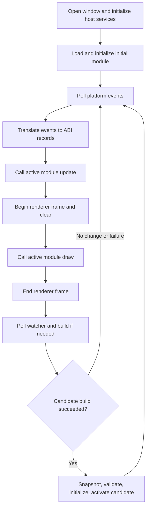
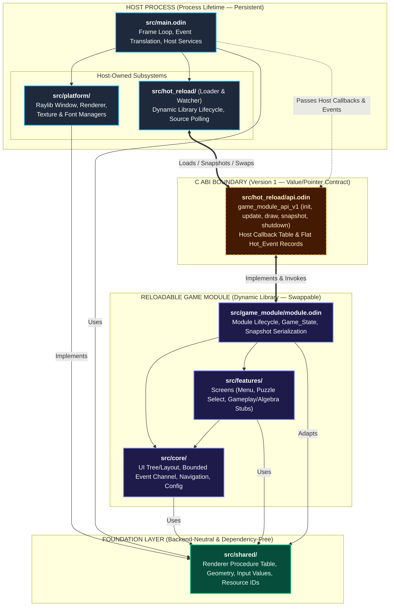

# Formula Arcana Architecture

**Status:** Describes the current implementation, including unfinished work; it is not a target-state specification.  
**Scope:** Runtime lifecycle, package responsibilities, module boundary, and contributor guidance.

## Overview

Formula Arcana is an Odin game application using Raylib for its window and drawing backend. A stable host process owns the window, platform services, renderer, event polling, and frame loop. Game logic is loaded from a dynamically linked module and can be replaced during development without restarting the host.

The current codebase contains an interactive main menu and a puzzle-selection flow, plus a gameplay foundation that is still in progress. Archives and Settings are placeholders. Gameplay and equation-algebra code contain explicit stubs; their presence does not mean the feature is complete. See [Current implementation status](#current-implementation-status).

## Quick orientation

| Concern | Current location | Responsibility |
| --- | --- | --- |
| Host process and frame loop | `src/main.odin` | Window lifetime, host services, event translation, update/draw calls, reload polling |
| Module implementation | `src/game_module/module.odin` | Module state, screen composition, ABI callbacks, snapshot serialization |
| Screen flow and UI | `src/features/` | Screen state, navigation, menu, puzzle selection, gameplay scaffolding |
| Reusable application/UI foundations | `src/core/` | Events, navigation, configuration/progress values, UI tree and drawing |
| ABI and reload loader | `src/hot_reload/` | ABI declarations, dynamic library lifecycle, source watcher |
| Raylib integration | `src/platform/` | Window, renderer, texture and font managers |
| Backend-neutral contracts | `src/shared/` | Renderer, geometry, input and resource-ID values |
| Build and tests | `build.sh` | Format, build, module, run, test, and clean commands |
| Reload design details | `docs/hot-reload.md` | Detailed ABI, transaction, snapshot, and failure-handling notes |

## Runtime and frame flow

The host opens the window and initializes host-owned services before loading the first module. On each loop iteration it clears temporary allocations, collects and translates platform events, updates the active module, draws it inside a renderer frame, and then checks for a completed development build/reload request.



The current update API has no delta-time argument. Platform events are delivered as a flat array of ABI event records. The host tracks window dimensions from resize events and supplies the current dimensions when initializing a replacement module.

## Packages and responsibilities

Odin treats each directory as a package. The layout below describes current code, not a requirement to create a package for every feature.

```text
src/
├── main.odin                 # Stable process, window/frame loop, host services
├── game_module/              # Reloadable module implementation
├── core/                     # UI foundations, navigation, events, config/progress
├── features/                 # Screen flow and game-facing feature code
├── hot_reload/               # ABI, loader, and development source watcher
├── platform/                 # Raylib window, renderer, texture/font managers
└── shared/                   # Backend-neutral contracts and value types
```

### Host: `src/main.odin`

The host remains loaded for the process lifetime. It owns the Raylib window, renderer, texture and font managers, event collection, and development reloader. It translates platform events into `Hot_Event` values, calls module update and draw callbacks, and invokes reload processing after the draw callback and renderer frame have completed.

Host callbacks expose logging, resource loading, text measurement, and drawing. The module calls them through the ABI; game code does not call Raylib directly.

### Reloadable module: `src/game_module/`

`module.odin` exports `game_module_api_v1` with initialize, update, draw, snapshot, and shutdown callbacks. The module owns `Game_State`, including feature context and active screen state. It adapts the shared renderer and asset-loading calls to host callbacks.

### Features: `src/features/`

`screens.odin` defines the active screen union and routes screen entry, update, resize, and drawing. `main_menu.odin` implements the menu; `puzzle_selection.odin` implements the puzzle-selection screen. `gameplay.odin` and `algebra.odin` define a gameplay/domain direction but currently contain explicit stubs. Settings and Archives are placeholder screens in `screens.odin`.

Keep screen-specific state and behavior together in this package. A domain concept may start in the existing package; add a separate feature package only when the code's cohesion and dependencies justify it.

### Core: `src/core/`

Core contains reusable foundations: the bounded event channel, navigation values, configuration and progress data, the generic UI tree/layout implementation, and UI drawing helpers. Use it for mechanisms that are genuinely shared, rather than as a default home for feature-specific rules.

### Platform: `src/platform/`

Platform wraps Raylib window operations, rendering, and texture/font loading. It implements the backend-neutral renderer contract. Window, renderer, and resource managers remain host-owned across game-module reloads.

### Shared: `src/shared/`

Shared defines backend-neutral values and contracts used across package boundaries: vectors, rectangles, viewport scaling, input event values, resource IDs, colors, and the renderer procedure table. Keep this layer small and independent of Raylib and feature-specific state.

### Assets and build

`assets/` contains the current menu background and font. `build.sh` provides `format`, `build`, `module`, `run`, `test`, and `clean` commands; build artifacts go under `bin/`. The test command runs the `core` and `features` package suites.

## Dependency direction

The current practical dependency boundaries are:

- `features` depends on `core` and `shared`.
- `core` uses `shared` values and renderer contracts where needed.
- `platform` implements shared renderer/resource behavior using Raylib.
- `game_module` composes `core`, `features`, `shared`, and the ABI definitions.
- `main` composes host-side `core`, `platform`, `shared`, and `hot_reload`.
- `hot_reload/api.odin` stays independent of game packages so the ABI remains explicit and small.



### Where should a change go?

| Change | Likely location | Guideline |
| --- | --- | --- |
| New screen or screen-specific rules | `src/features/` | Keep its state, update, and drawing logic with the feature/screen flow. |
| Generic UI tree/layout behavior reused by screens | `src/core/` | Keep reusable UI foundations independent of a particular screen. |
| Raylib window, drawing, or resource-manager implementation | `src/platform/` | Keep backend-specific calls at the platform edge. |
| Backend-neutral renderer contract or shared value type | `src/shared/` | Add only values/contracts needed across package boundaries. |
| ABI field, callback, or event record | `src/hot_reload/api.odin` | Preserve fixed layout and update/validate compatibility deliberately. |
| Host reload policy or dynamic-library handling | `src/hot_reload/` | Keep process-lifetime loading policy out of game feature code. |
| Host frame-loop or service wiring | `src/main.odin` | Keep window, callback table, and orchestration host-owned. |

## Module boundary and ownership

The host/module boundary is a C ABI boundary, not an ordinary Odin package interface. `src/hot_reload/api.odin` defines ABI version 1, fixed-width fields, raw pointers, C strings, flat event records, and callback tables. Do not pass Odin-managed strings, slices, unions, maps, allocators, or game structs across this boundary. Host and module must agree on target, calling convention, integer widths, field layout, and ownership rules.

| Resource or state | Owner | Lifetime and rule |
| --- | --- | --- |
| Window, event polling, renderer, texture/font managers | Host | Process lifetime; a module must not destroy them. |
| Active module handle, API table, and callbacks | Host loader | Until that module is shut down and unloaded; never call a module callback after unload. |
| Game/screen state and module allocations | Active module | Released by that module's shutdown callback before unload. |
| Host callback table and `user_data` | Host | Valid while the module is active, per the API contract. |
| Snapshot bytes during replacement | Host | Temporary host-owned copy; opaque to the host and copied before unloading the old module. |
| Texture/font resources created through host callbacks | Host managers | Survive module replacement; current ABI does not expose a corresponding release callback. |

### Snapshot format currently implemented

The module snapshot is serialized data, not a raw copy of `Game_State`. The current format is two `u32` words (8 bytes): a module state version followed by a screen-category value. Version 1 preserves the active screen category only. Focus, pending settings, and other screen-local state are recreated from defaults.

The host queries the required size, allocates a host-owned buffer, asks the module to write it, and verifies the byte count. The loader rejects snapshot creation failures and snapshots larger than 16 MiB. The module currently initializes to the main menu if the snapshot is absent, shorter than 8 bytes, or has an unrecognized version; it does not implement a general migration system. Update this document and tests if the format or fallback behavior changes.

## Development reload and failure behavior

In the development workflow, the watcher polls source inputs, coalesces changes with a debounce, and runs `bash build.sh module`. A successful build writes a candidate shared library. The loader snapshots the active module, copies the candidate to a unique active filename, loads and validates the API version/table/callbacks, and initializes the candidate from the snapshot. Only after initialization succeeds does it switch active modules, shut down the old module, and unload it. The host executable and platform layer are not hot-reloaded.

Reload operations and module callbacks currently run synchronously through the host's main loop. Do not unload a module while one of its callbacks is running. If module code ever starts worker threads, those threads must be stopped and joined before shutdown/unload; the current ABI provides no thread-lifecycle mechanism.

| Failure | Current behavior |
| --- | --- |
| Build fails or candidate cannot be staged/loaded | Keep the current module active and report the failure. |
| Export, ABI version, table size, or required callback is invalid | Reject and unload the candidate; keep the current module active. |
| Snapshot creation fails or exceeds the loader limit | Abort replacement; keep the current module active. |
| Candidate initialization returns nil | Reject candidate; keep the current module active. |
| Candidate crashes inside a callback | Not recoverable by the in-process reload transaction. |
| Host resource is loaded during candidate initialization | The old module remains active on failure, but the current resource API has no rollback/release callback; avoid assuming such side effects are rolled back. |

The loader's rollback guarantee concerns which module remains active. It does not imply transactional rollback of host-service side effects performed during candidate initialization. In particular, asset loads can affect host-owned managers. Avoid relying on candidate initialization to make irreversible host-side changes until the host API provides a staging or cleanup mechanism.

## Current implementation status

### Implemented

- Stable host owns the window, platform event polling, renderer, resource managers, and frame loop.
- Versioned module API and host-service API are in place.
- Module update/draw calls and flat event translation are wired through the ABI.
- Development watcher builds a candidate and the loader validates and activates it while retaining the previous module on reported pre-activation failures.
- Main menu, puzzle-selection flow, core UI foundations, and package tests exist.

### Partial or placeholder

- Level Select is implemented as a puzzle-selection screen, but should not be read as a complete campaign/progression system.
- Settings and Archives render placeholders and return to the menu; persisted settings/progress behavior is not wired through these screens.
- Gameplay and algebra contain scaffolding/stubs. Verify the current tests and implementation before treating these systems as playable.
- Snapshot persistence currently covers only the screen category, not full screen state or game progress.
- Texture/font manager lifetime is host-wide, and the current ABI has no module-facing resource-release callback.

### Current limits

- The input surface currently covers mouse button edges, window resize, and navigation keys.
- The renderer exposes text, filled/outlined rectangles, and textures; it is not a general scene renderer.
- The update callback has no delta-time parameter.
- Hot reload requires compatible host/module targets and ABI layouts; it is a development workflow, not a general plugin compatibility promise.

## Build and test commands

Run from the repository root:

```sh
./build.sh format
./build.sh build          # debug by default
./build.sh build release
./build.sh run            # debug by default
./build.sh test
./build.sh clean
```

`./build.sh test` runs tests under `src/core` and `src/features`. The build script's test target does not currently list the host, platform, or reload transaction as test targets. Reload behavior therefore also needs runtime/manual validation.

## Maintaining this document

When changing package ownership, the ABI, snapshot format/fallback, event surface, frame order, build workflow, or feature completion status, update this document and the relevant tests. Keep implementation facts separate from design intentions, and link to `docs/hot-reload.md` for detailed reload protocol changes.
