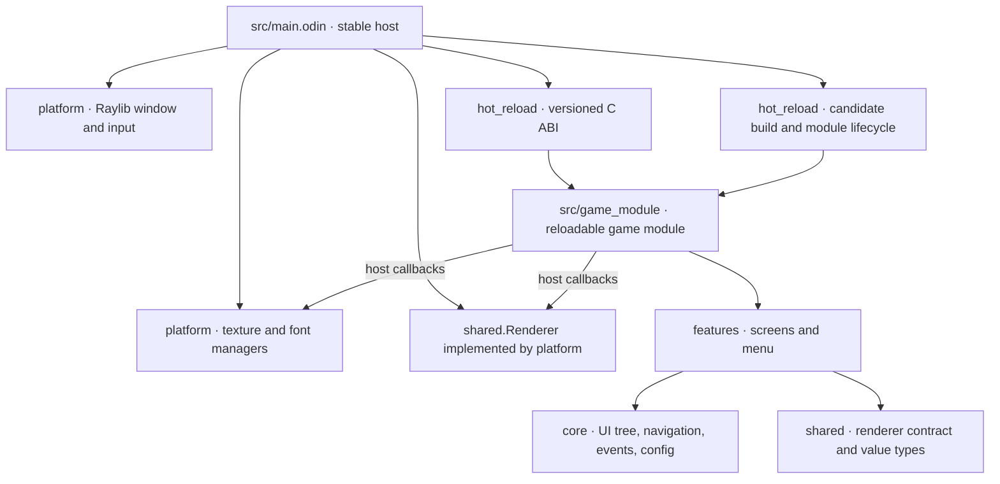

# Formula Arcana Architecture

**Scope:** High-level structure and runtime responsibilities of the current project.

**Status:** Describes the implementation in this repository; unfinished screens and features are identified as such.

## Overview

Formula Arcana is a small Odin game application using Raylib for its window and drawing backend. The process is split into a stable host and a dynamically loaded game module. The host owns platform resources and the frame loop; the module owns the active screen and game logic. In debug development, source changes can trigger a build and activate a replacement module while the window remains open.

The current game-facing content is an interactive main menu plus placeholder Level Select, Archives, and Settings screens. This is an early foundation, not yet a broad collection of gameplay feature packages.

## Project principles

These principles guide how the project should grow. They describe the intended structure, including parts that are not yet represented by multiple feature packages in the current code.

1. **Organize by vertical slice.** Group code around a game capability or domain concept, so its state, behavior, UI, and tests can be understood and changed together. Prefer a cohesive feature package over scattering one feature across generic `systems/`, `components/`, and `views/` layers.
2. **Co-locate what changes together.** Keep a feature's data, update and rendering logic, and tests near one another. Keep assets alongside the feature when practical, or in a clearly corresponding asset directory. Do not create empty directory structure for hypothetical features.
3. **Keep package boundaries explicit.** Odin maps directories to packages. Use that boundary for cohesive features and shared foundations, and keep imports moving toward stable, reusable contracts rather than coupling one feature directly to another.
4. **Keep shared foundations small and general.** Put cross-feature primitives and application-wide mechanisms in `core` or `shared` only when they are genuinely reused or define a stable contract. Feature-specific rules belong with the feature that owns them.
5. **Keep platform details at the edge.** Game and UI code use backend-neutral renderer, input, and resource contracts. Raylib calls and ownership of GPU resources stay in `platform` and the host.
6. **Treat reload as an explicit boundary.** The host owns process-lifetime services; the game module owns reloadable game state. Only the versioned, ABI-safe API and opaque snapshot bytes cross between them.

Vertical slicing is a design direction, not a claim that every current directory is already a feature slice. The current `features` package contains the menu and screen flow together; as the game gains distinct capabilities, split them into cohesive feature packages when that improves ownership and change locality.

## Runtime shape



At startup, `main` opens the window, creates host-owned resource managers and renderer, builds the host callback table, and loads the initial module candidate. Each frame, the host polls Raylib input and window events, converts them into ABI-safe event records, calls module `update`, draws through the module, then checks for a completed development rebuild. A successful candidate is activated at the frame boundary.

## Packages and responsibilities

Odin treats each directory as a package. The current source layout is:

```text
src/
├── main.odin                 # Stable process, window/frame loop, host services
├── game_module/              # Reloadable game module and module-owned state
├── core/                     # UI tree/layout/drawing, navigation, config, event channel
├── features/                 # Screen state/transitions and main menu
├── hot_reload/               # ABI declarations, dynamic loader, dev source watcher
├── platform/                 # Raylib window/renderer and texture/font managers
└── shared/                   # Backend-neutral renderer contract, geometry, input/resource IDs
```

### Host: `src/main.odin`

The host remains loaded for the lifetime of the process. It owns the Raylib window, renderer, texture and font managers, event collection, and development reloader. It translates platform events into the flat event format in `hot_reload/api.odin`. It does not own the screen state.

### Reloadable module: `src/game_module/`

The module exports `game_module_api_v1`, which provides initialize, update, draw, snapshot, and shutdown callbacks. It owns `Game_State`, including the feature context and active screen union. Its renderer adapter forwards drawing and asset requests to host callbacks, so the module does not call Raylib directly or own GPU resources.

### Game UI: `src/features/`

`screens.odin` owns the screen state union and routes transitions. `main_menu.odin` constructs and lays out the menu UI tree, handles mouse and navigation-key input, and requests screen navigation. The other current screens render placeholders and support returning to the menu. `Context` passes configuration, progress, viewport, renderer, and asset loader procedures to screens.

### Core: `src/core/`

Core contains reusable application/UI foundations: the bounded event channel, navigation values, configuration and progress data, a generic UI tree/layout implementation, and UI drawing helpers. The current game module directly routes ABI events to the active screen; the event channel is used by the host to collect platform events.

### Platform: `src/platform/`

Platform code wraps Raylib window operations, rendering, and texture/font loading. The renderer implementation is supplied to the game through the backend-neutral `shared.Renderer` contract. Resource managers stay in the host across game-module reloads.

### Shared: `src/shared/`

Shared defines small backend-neutral values and contracts used across package boundaries: vectors, rectangles, viewport scaling, input event values, resource IDs, colors, and the renderer procedure table. It is intentionally not a feature package.

### Assets and build

`assets/` currently contains the main menu background and font. `build.sh` builds the host executable and reloadable debug module, copies assets beside the executable, and provides format, run, test, and clean commands. Build outputs are written under `bin/`.

## Module boundary and ownership

The host/module boundary is an ABI boundary, not an ordinary Odin package interface. `hot_reload/api.odin` uses ABI version 1 and fixed-width fields, raw pointers, C strings, and flat event records. Odin-managed strings, slices, unions, allocators, and game structs do not cross it. Both host and module must agree on ABI version, structure size, and C calling convention.

| Resource or state | Owner | Lifetime |
| --- | --- | --- |
| Window, platform event polling, renderer, texture/font managers | Host | Process lifetime |
| Active module handle and callback table | Host loader | Until a replacement is activated or the app exits |
| Screen state and feature context | Active game module | Until that module shuts down |
| Snapshot bytes during replacement | Host | Temporary; copied before the old module unloads |

The module snapshots state into bytes before replacement and the next module restores from those bytes during initialization. Snapshot contents are module-defined and versioned; the host treats them as opaque data. The current implementation preserves a small set of navigation destinations and otherwise starts at the main menu.

## Development reload flow

The debug host watches `src/` and `build.sh`, coalesces edits with a debounce, then runs `bash build.sh module`. A successful build creates a candidate library. At a frame boundary, the loader snapshots the active state, copies the candidate to a unique active filename, loads it, validates its exported API, and initializes it with the snapshot. Only after successful initialization does it shut down and unload the previous module. Build, load, validation, or restore failures leave the current module running.

The host executable and platform layer are not hot-reloaded. Release builds also compile the module, but automatic source watching is a development workflow.

## Dependency direction

The current code follows these practical boundaries:

- `features` depends on `core` and `shared`.
- `core` uses `shared` value types and renderer contracts where needed.
- `platform` implements the shared renderer and resource services using Raylib.
- `game_module` composes `core`, `features`, `shared`, and the ABI definitions.
- `main` composes the host-side `core`, `platform`, `shared`, and `hot_reload` packages.
- `hot_reload/api.odin` stays independent of game packages so the ABI remains a small, explicit boundary.

There is currently one feature package and one active screen flow. Add further game concepts where they fit the actual code; do not assume every concept needs a new feature directory or event-channel integration before it exists. When features do become separate packages, avoid direct feature-to-feature imports; move truly shared contracts to a stable lower-level package or route cross-feature requests through an explicit application-level mechanism.

## Current limits

- Level Select, Settings, and Archives are placeholders; persisted settings/progress behavior is not yet wired through the screen flow.
- The input surface currently covers mouse button edges, window resize, and four navigation keys.
- The renderer exposes text, filled/outlined rectangles, and textures; it is not a general scene renderer.
- Hot reload is intended for development and depends on the host and module being built for the same target with a compatible ABI.
