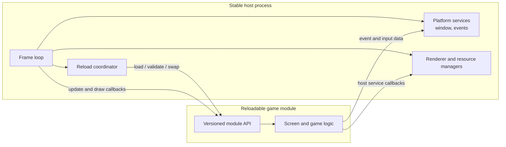
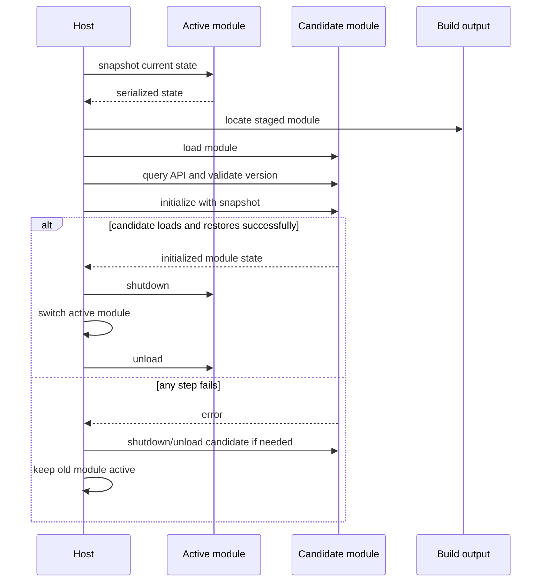
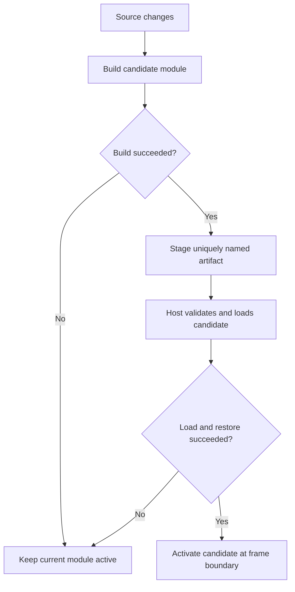

# Code Hot-Reload Technical Design

**Status:** Initial debug implementation
**Scope:** Runtime reload of game logic  
**Applies to:** Formula Arcana

## 1. Summary

The application will keep a small, stable host process responsible for the window,
platform services, frame loop, and reload orchestration. Game and screen logic will
be built as a dynamically loadable module. When a replacement module is ready, the
host will snapshot game state, load and validate the replacement, restore state,
and switch to it at a frame boundary.

The first version should prioritize safe, explicit reloads over preserving every
piece of in-memory state. If a replacement cannot be built, loaded, or restored, the
currently running module should remain active.

## 2. Goals

- Reload game and screen logic without restarting the process or recreating the window.
- Keep platform-owned resources, including the window and renderer, in the host.
- Avoid depending on the in-memory layout of game state remaining unchanged between
  builds.
- Keep the previous module running if a replacement fails validation or state restore.
- Reload changed game code automatically in debug builds through a debounced source watcher.

## 3. Non-goals

- Hot-reloading the host executable, Odin compiler, or platform layer.
- Guaranteeing that arbitrary changes to game state can be migrated automatically.
- Reloading assets; that is a separate feature.
- Running old and new game modules concurrently.

## 4. Current structure

`main.odin` currently owns the application loop and directly calls into `features`:

```text
main
 ├─ polls platform events
 ├─ handles window resize
 ├─ updates the active screen
 └─ draws the active screen
```

The active screen and shared context live in `Game`. To reload game code while
keeping the process alive, the host must stop calling game logic through statically
linked functions and instead call through a module interface.

## 5. Proposed architecture



The host owns the module handle and controls its lifetime. The module provides a
versioned API table with callbacks for initialization, update, draw, state snapshot,
state restore, and shutdown.

The module boundary should be treated as an ABI boundary, not as an ordinary Odin
package boundary. Keep values crossing it simple and explicitly versioned. Avoid
passing compiler-managed or layout-sensitive values across the boundary unless the
ABI contract guarantees their compatibility.

### 5.1 Ownership

| Resource | Owner | Notes |
| --- | --- | --- |
| Window and platform event loop | Host | Remains alive across reloads. |
| Renderer and texture/font managers | Host | Must not be destroyed when game logic reloads. |
| Module handle and callbacks | Host | Replaced only after a candidate module is validated. |
| Active game state | Active module | Snapshot before replacement; restore in the new module. |
| Snapshot bytes | Host during reload | Copy into host-owned memory before unloading the old module. |

## 6. Module interface

The exact Odin declarations and platform loader calls should be selected during
implementation. Conceptually, the module exports one entry point that returns a
versioned function table:

```text
Game_Module_API
 ├─ abi_version
 ├─ initialize(host_api, state_blob) -> module_state
 ├─ update(module_state, events)
 ├─ draw(module_state)
 ├─ snapshot(module_state) -> state_blob
 └─ shutdown(module_state)
```

Requirements:

- The API version and required callbacks are validated before activation.
- The host and module agree on calling convention, integer widths, ownership, and
  string/buffer representation.
- State snapshots use a versioned serialization format rather than raw struct copies.
- Snapshot memory is copied into host-owned storage before the old module is unloaded.
- Module-owned allocations and resources are released by that module before it is
  unloaded.
- Host services are exposed through a narrow, versioned table. The module should not
  own the window or independently destroy host resources.

The existing `features.Context` and `features.Screen_State` should not automatically
be treated as stable ABI types. Their suitability depends on their fields and
ownership; this needs to be checked during implementation.

## 7. Reload lifecycle

Reloading occurs on the main thread at a frame boundary, when no module callback is
executing.



The old module is not unloaded until the candidate has passed validation and
initialization. If initialization requires host resources that cannot coexist with
the old module, the implementation must define a rollback-safe replacement
procedure before enabling that behavior.

## 8. Build and artifact staging

The build process should produce a candidate artifact separately from the active
module. The host should load the candidate only after the build has completed.



Use unique or versioned staged filenames rather than overwriting the currently
loaded library. This avoids platform-specific problems with replacing a loaded
dynamic library. The file watcher and build command are intentionally left
platform-specific until the supported operating systems and build setup are known.

For the initial implementation, reload can be triggered manually (for example,
through a development-only key binding). Automatic watching and invoking the
compiler should be a later phase.

## 9. State migration

Raw memory from the old module must not be passed directly to the new module. A
struct layout can change between builds, and module-owned allocations or callbacks
may no longer be valid after unload.

Instead:

1. The old module serializes the state it wants to preserve.
2. The host copies the serialized bytes into host-owned memory.
3. The old module shuts down and is unloaded.
4. The new module reads the snapshot and applies migrations based on its schema
   version.
5. If restoration fails, the host reports the error and follows the selected
   fallback policy.

The snapshot format should include a schema version. The first implementation may
support only the current version and fall back to a clean game state when it
encounters an incompatible snapshot.

## 10. Failure handling

| Failure | Expected behavior |
| --- | --- |
| Build fails | Keep running the active module; report the build failure. |
| Candidate artifact is missing or unreadable | Keep the active module. |
| Module cannot be loaded | Keep the active module. |
| API version or required callback is invalid | Reject and unload the candidate. |
| State restoration fails | Reject the candidate or start from a clean state, according to the configured policy. |
| Candidate crashes during initialization | This is not safely recoverable in-process; consider process isolation only if it becomes a requirement. |

Reload errors should be visible in the development log. They should not terminate
the application unless the active module itself fails.

## 11. Threading and safety

- The initial implementation is single-threaded for reload operations.
- Do not unload a module while one of its callbacks is running.
- Any future worker threads started by a module must be stopped and joined before
  that module is unloaded.
- Do not retain function pointers or callbacks into an old module after unload.
- The host must own any data that must survive the old module's lifetime.

## 12. Implementation phases

### Phase 1: Module boundary — implemented

- Identify which `features` code belongs in the reloadable module.
- Keep window creation, event polling, and frame orchestration in the host.
- Define the versioned module API and host-service API.
- Decide how renderer and resource-manager access crosses the boundary.

### Phase 2: Module load and activation — implemented for debug builds

- Build the game logic as a dynamically loadable module.
- Add module load, validation, activation, shutdown, and unload handling.
- The debug host loads `game_module_api_v1` from a staged Odin shared library.
- The host validates ABI version, table size, and required callbacks before activation.
- Reload snapshots, initializes, and validates the candidate before shutting down the active module.
- The first snapshot schema preserves the active screen category. Screen-local focus and pending settings are recreated from defaults.

### Phase 3: Robust state migration — remaining

- Define a serialized game-state schema.
- Add migration behavior and tests for incompatible snapshot versions.
- Exercise reloads while navigating between screens and after window resize events.

### Phase 4: Automatic rebuild and reload — initial watcher implemented

- The host polls `src/` and `build.sh`, debounces changes, and builds `bin/debug/game_module_candidate`.
- The candidate is copied to a unique filename before loading, so the active library is never overwritten.
- Activation occurs in the main loop after a successful build, after the module's draw callback has returned.
- Build, load, validation, and restoration errors leave the active module running.

## 13. Testing checklist

- The host window remains open through repeated reloads.
- A successful reload activates the new logic.
- A failed build leaves the current module usable.
- An invalid API version is rejected without replacing the active module.
- State restoration works for the supported snapshot version.
- An unsupported snapshot version follows the documented fallback policy.
- Window resize events still update the active screen after reload.
- Renderer and resource-manager ownership remains with the host.
- No callbacks into an unloaded module remain registered or in use.

## 14. Decisions to make before broader rollout

1. Expand the snapshot schema to preserve selected difficulty, settings, progress, and menu focus.
2. Add explicit host resource release or caching for textures and fonts loaded by repeated screen initialization.
3. Verify the compiler and shared-library build flags on each supported operating system.
4. Decide whether incompatible snapshots reject the reload or start a fresh game state.
