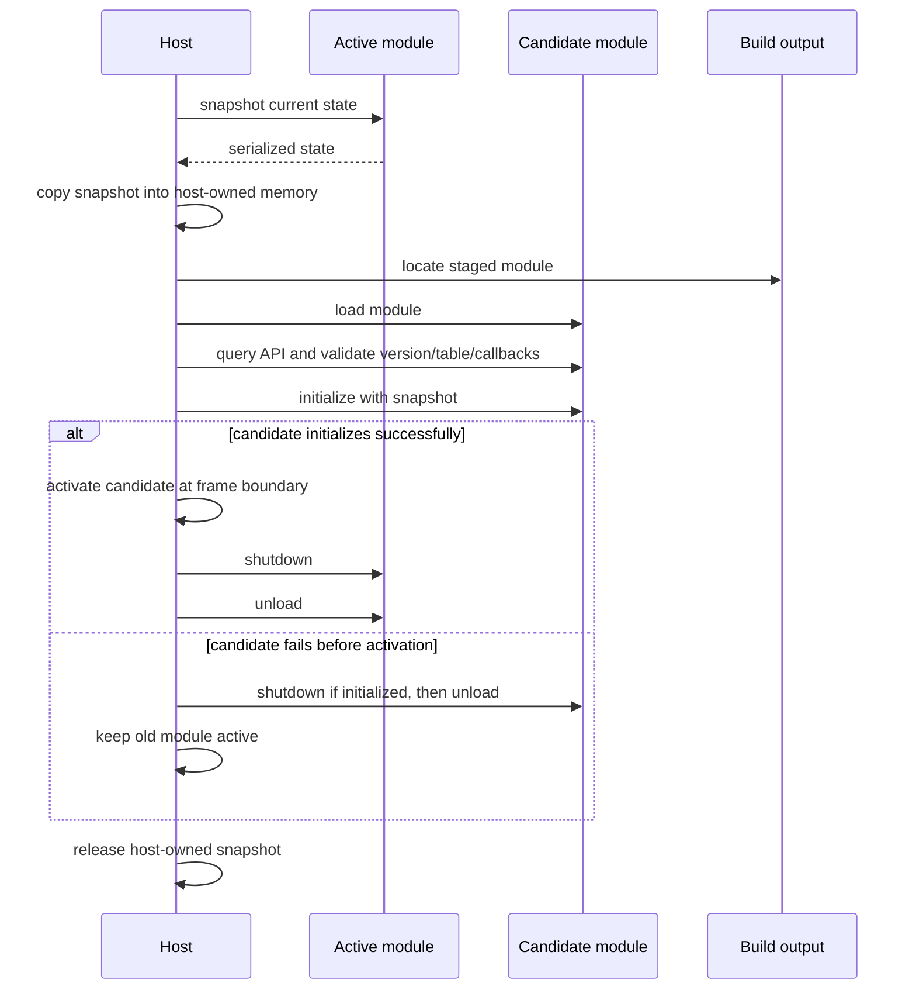
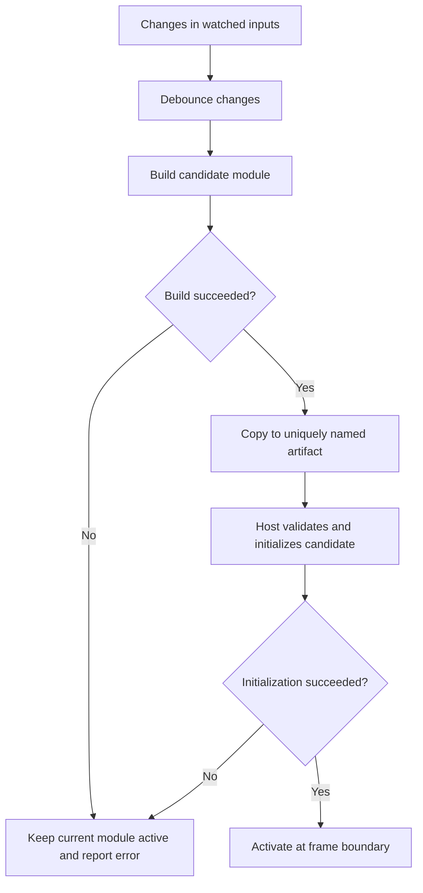

# Code Hot-Reload Technical Design

**Status:** Implemented for debug builds; state migration and portability work remain  
**Scope:** Runtime reload of game logic  
**Applies to:** Formula Arcana

## 1. Summary

The application keeps a stable host process responsible for the window, platform
services, frame loop, renderer, and reload orchestration. In debug builds, game and
screen logic run from a dynamically loadable module. When a replacement is ready,
the host snapshots the supported game state, loads and validates the replacement,
initializes it from the snapshot, and activates it at a frame boundary.

The current snapshot preserves the active screen category only. Screen-local focus
and pending settings are recreated from defaults; this is not a general state
migration system. If building, loading, validation, or restoration fails, the host
keeps the active module running.

## 2. Goals

- Reload game and screen logic without restarting the process or recreating the window.
- Keep platform-owned resources, including the window and renderer, in the host.
- Avoid depending on the in-memory layout of game state remaining unchanged between
  builds.
- Keep the previous module running if a replacement fails validation or state restore.
- Automatically rebuild changed game code in debug builds using the host's debounced
  source watcher.

## 3. Non-goals

- Hot-reloading the host executable, Odin compiler, or platform layer.
- Automatically migrating arbitrary changes to game state.
- Reloading assets; that is a separate feature.
- Running old and new game modules concurrently as active game logic.

## 4. Current architecture

The host owns the application loop and platform lifecycle. In the debug hot-reload
configuration, it calls game logic through the dynamically loaded module API rather
than relying on game logic being statically linked into the host.

```text
Host
 ├─ polls platform events and handles window resize
 ├─ owns the window, renderer, and resource managers
 ├─ runs the frame loop
 └─ coordinates module build, load, validation, and activation

Game module
 ├─ owns game and screen logic and its active game state
 └─ calls host services through the module boundary
```

The module boundary is an ABI boundary, not an ordinary Odin package boundary.
Values crossing it must follow the API's explicit layout and ownership rules. Do not
pass compiler-managed or layout-sensitive values across it unless the ABI contract
explicitly supports them.

### 4.1 Ownership

| Resource | Owner | Notes |
| --- | --- | --- |
| Window and platform event loop | Host | Remains alive across reloads. |
| Renderer and texture/font managers | Host | Must not be destroyed when game logic reloads. |
| Module handle and callbacks | Host | Candidate replaces the active module only after successful validation and initialization. |
| Active game state | Active module | The supported snapshot is produced before replacement. |
| Snapshot bytes | Host during reload | Must be copied into host-owned storage before the old module is unloaded. |

## 5. Module interface and ABI contract

The debug host loads the `game_module_api_v1` entry point from a staged Odin shared
library. The entry point provides a versioned API table. Conceptually, that table
contains:

```text
Game_Module_API
 ├─ abi_version and table size
 ├─ initialize(host_api, state_blob) -> module_state
 ├─ update(module_state, events)
 ├─ draw(module_state)
 ├─ snapshot(module_state) -> state_blob
 └─ shutdown(module_state)
```

The host validates the ABI version, table size, and required callbacks before it
uses a candidate. The following are ABI requirements, not implementation details to
infer from Odin package compatibility:

- Host and module must agree on calling convention, integer widths, field layout,
  and the representation and ownership of strings and buffers.
- Snapshot data must be serialized data, not a raw copy of module state. It must not
  contain pointers, callbacks, or allocations owned by the module being replaced.
- Snapshot bytes must be copied into host-owned memory before the old module is
  unloaded. The API must define who releases any buffer returned by a callback.
- Module-owned allocations and resources must be released by that module before it
  is unloaded. Host-owned resources must only be released by the host.
- Host services must be exposed through a narrow, versioned table. The module must
  not own the window or independently destroy host resources.
- No callback or function pointer into a module may be retained or used after that
  module is unloaded.

The existing `features.Context` and `features.Screen_State` are not assumed to be
stable ABI types. Their fields and ownership must be checked before either is used
across the module boundary.

## 6. Reload transaction

Reloading runs on the main thread at a frame boundary, after the current module's
callback has returned. The host keeps the old module loaded and active while it
validates and initializes the candidate. The transaction is:

1. Ask the active module to serialize its supported state.
2. Copy the snapshot into host-owned memory.
3. Load the staged candidate and validate its API version, table size, and required
   callbacks.
4. Initialize the candidate from the snapshot. Candidate initialization must not
   irreversibly modify host-owned state or resources before activation; any staged
   host-side changes must be discardable if initialization fails.
5. If initialization succeeds, switch the active module at the frame boundary,
   shut down the old module, and unload it. Release the host-owned snapshot.
6. If any recoverable step before activation fails, shut down and unload the
   candidate if it was initialized, release the snapshot, report the error, and keep
   the old module active.

The implementation must preserve this rollback property when exposing host services
to candidate initialization. If a service cannot stage or undo a side effect, it
must not be used by candidate initialization before activation. A crash during a
module callback is not recoverable in-process; this design only handles reported
errors.



A failure during old-module shutdown occurs after activation and cannot be treated as
a candidate-validation failure. Shutdown must release module-owned resources without
destroying host-owned resources. The exact recovery from a shutdown error remains an
implementation limitation; it must be reported and must not trigger calls into an
unloaded module.

## 7. Build, staging, and automatic reload

The debug host polls `src/` and `build.sh`, debounces detected changes, and builds
`bin/debug/game_module_candidate`. After a successful build, the candidate is copied
to a unique filename before loading so the active shared library is never
 overwritten in place. Activation occurs in the main loop after the module's draw
callback has returned.



The watcher paths, candidate output path, and unique-artifact behavior above are the
current documented behavior. The debounce interval, build invocation details,
ignored paths, and behavior when inputs change during an in-progress build are not
specified here; document them from the implementation before relying on them across
platforms. Build and shared-library behavior is currently described for debug builds
only. The host loads only a completed, staged candidate; it must not load a partially
written build output.

## 8. Snapshot and state migration

Raw memory from the old module must never be passed directly to the new module. A
struct layout can change between builds, and module-owned allocations or callbacks
may no longer be valid after unload.

The current first snapshot preserves the active screen category. Screen-local focus
and pending settings are recreated from defaults. Broader preservation of difficulty,
settings, progress, and menu focus is future work.

The reload transaction keeps the old module loaded while the candidate reads and
restores the host-owned serialized snapshot. Only after candidate initialization
succeeds does the host activate it and shut down the old module. This ordering is
required to keep the current module available if restoration fails.

The snapshot schema and migration behavior beyond the currently supported state are
not yet a complete compatibility contract. Until versioned migrations are added, an
unsupported or invalid snapshot rejects the candidate; the host does not silently
start a clean game state. Any future change to that fallback policy must update this
document and the tests together.

## 9. Failure handling

| Failure | Expected behavior |
| --- | --- |
| Build fails | Keep running the active module and report the build failure. |
| Candidate artifact is missing or unreadable | Keep the active module. |
| Module cannot be loaded | Keep the active module. |
| API version, table size, or required callback is invalid | Reject and unload the candidate. |
| Snapshot creation or copying fails | Abort the reload and keep the active module. |
| Candidate initialization or state restoration fails | Shut down/unload the candidate if possible; keep the active module. |
| Candidate crashes during a callback | Not safely recoverable in-process; process isolation is outside this design. |
| Old module shutdown reports an error after activation | Report the error; do not call into that module after unload. Recovery is an implementation limitation. |

Reload and build errors should be visible in the development log. Recoverable reload
failures must not terminate the application or replace the active module.

## 10. Threading and safety

- Reload operations run on the main thread.
- Do not unload a module while one of its callbacks is running.
- Any worker threads started by a module must be stopped and joined before that
  module is unloaded.
- Do not retain function pointers or callbacks into an old module after unload.
- The host must own any data that must survive the old module's lifetime.

## 11. Implementation status and remaining work

### Module boundary — implemented

- Game logic is separated into a reloadable module for the debug host.
- Window creation, event polling, and frame orchestration remain host-owned.
- A versioned module API and host-service API are used.
- Renderer and resource-manager access crosses the boundary through host services.

### Module load and activation — implemented for debug builds

- The debug host loads `game_module_api_v1` from a staged Odin shared library.
- The host validates ABI version, table size, and required callbacks before activation.
- Reload snapshots and initializes the candidate before shutting down the active
  module.
- The first snapshot preserves the active screen category; screen-local focus and
  pending settings are recreated from defaults.

### Automatic rebuild and reload — initial watcher implemented

- The host polls `src/` and `build.sh`, debounces changes, and builds
  `bin/debug/game_module_candidate`.
- The candidate is copied to a unique filename before loading.
- Activation occurs in the main loop after the module's draw callback has returned.
- Build, load, validation, and restoration errors leave the active module running.

### Robust state migration and portability — remaining

- Define and version a serialized game-state schema for additional state.
- Add migration behavior and tests for unsupported or incompatible snapshot versions.
- Exercise reloads while navigating between screens and after window resize events.
- Verify compiler and shared-library build flags on each supported operating system.
- Confirm resource cleanup or caching for textures and fonts across repeated screen
  initialization.
- Document watcher debounce timing, ignored paths, build invocation, and changes
  detected during an in-progress build from the implementation.

## 12. Testing checklist

- The host window remains open through repeated successful reloads.
- A successful reload activates the new logic at a frame boundary.
- A failed build leaves the current module usable.
- Missing, unreadable, or unloadable candidate artifacts leave the current module
  usable.
- An invalid API version, table size, or required callback is rejected without
  replacing the active module.
- Snapshot creation or copying failure leaves the current module active.
- Candidate initialization or restoration failure cleans up the candidate and leaves
  the current module active.
- The supported snapshot preserves the active screen category; focus and pending
  settings are recreated from defaults.
- Unsupported snapshot versions reject the candidate and preserve the active module.
- Window resize events still update the active screen after reload.
- Repeated reloads do not destroy host-owned renderer or resource-manager state or
  leak module-owned resources.
- No callbacks into an unloaded module remain registered or in use.
- Watcher-triggered builds use a completed, uniquely staged artifact and do not
  overwrite the active library.

## 13. Decisions before broader rollout

1. Expand the snapshot schema to preserve selected difficulty, settings, progress,
   and menu focus.
2. Add explicit host resource release or caching for textures and fonts loaded by
   repeated screen initialization.
3. Verify compiler and shared-library build flags on each supported operating system.
4. Specify and test watcher timing, ignored paths, build invocation, and behavior
   when watched inputs change during a build.
5. Define recovery behavior for an error during old-module shutdown after the new
   module has been activated.
